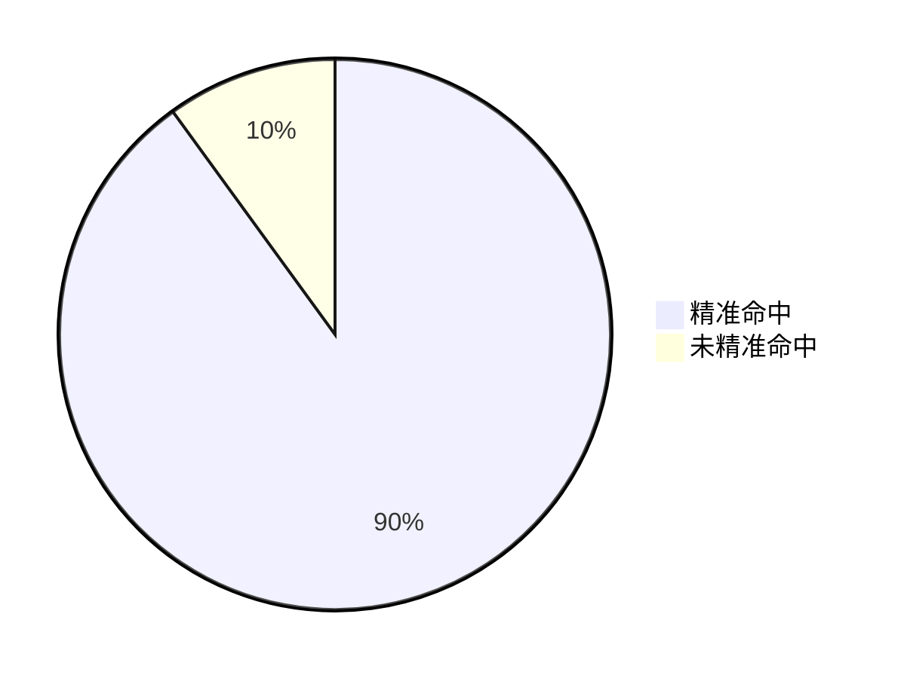
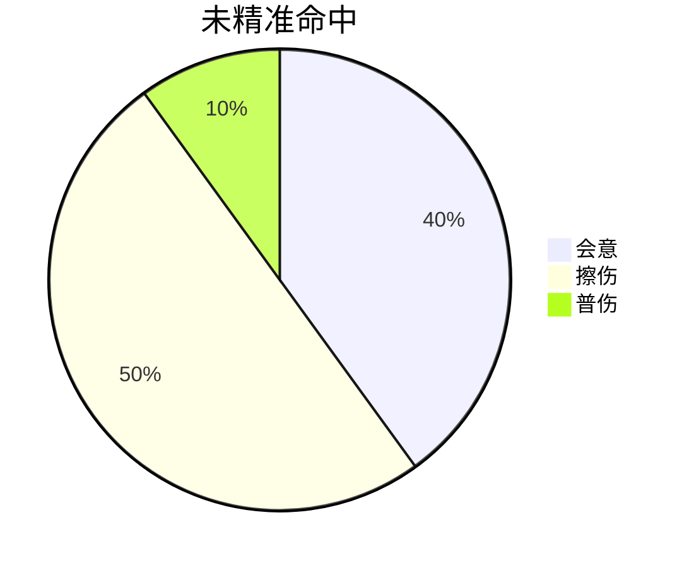
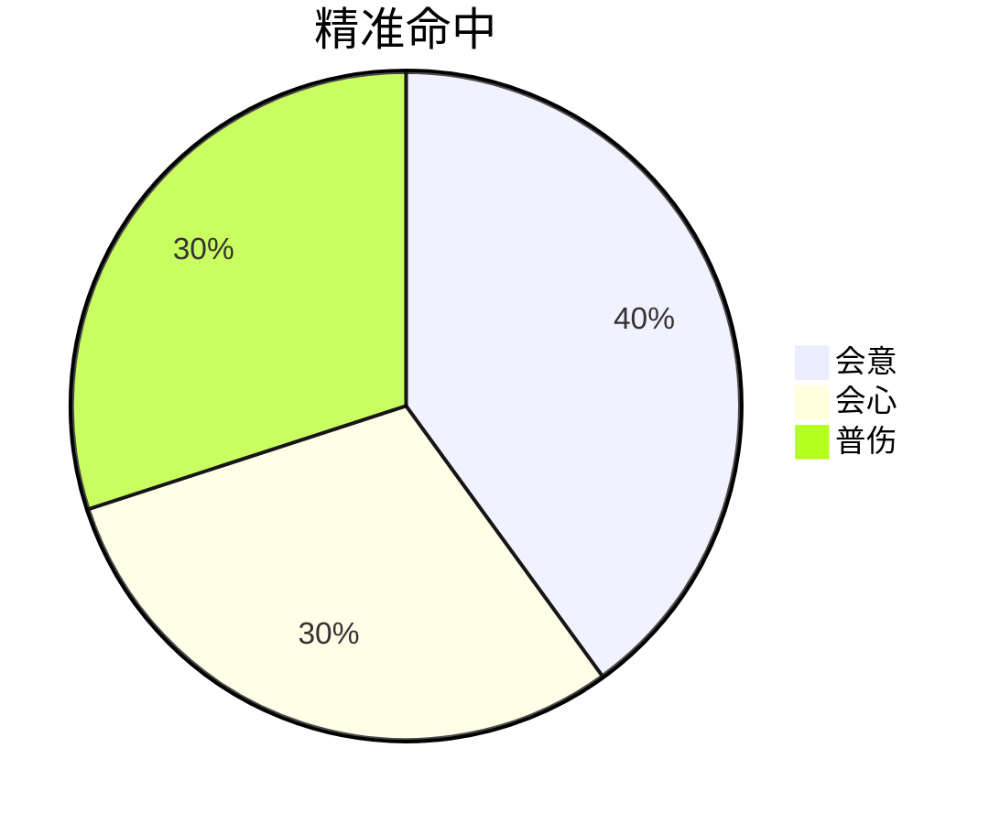

在《燕云十六声》里，玩家控制角色攻击一下到最终伤害跳字出现，至少有三个阶段的流程。

第一个阶段是根据精准率判定是否触发精准命中。
燕云中精准率意思是玩家的操作命中目标有效部位的概率。
燕云中不会出现”miss“，即命中率永远为100%，精准率只是区分是否命中有效部位。

在第二个阶段中，如果没有触发精准命中，则根据会意率判定是否触发会意。如果没有触发会意，则根据擦伤转化率判断是触发擦伤还是普伤。

在第二个阶段中，如果触发精准，则根据会意率、会心率共同判断会触发什么伤害。如果既没有触发会心也没有触发会意，则触发普伤。

无论是否精准命中，以及无论第二阶段触发了什么样的伤害，在走完前两个流程得到一个伤害数值之后，都进入到第三个阶段，在此数值基础上再算各种增伤减伤穿透等等乘区。

---

暂时忽略其他乘区，先关注四种伤害：擦伤、会意、普伤、会心。

擦伤在游戏里表现为灰色伤害跳字；会意表现为橙色伤害跳字；普通伤害表现为白色伤害跳字；会心表现为黄色伤害跳字。

擦伤伤害与会意伤害是一对，分别按固定的最小外功攻击和最大外功攻击计算，只不过擦伤的系数固定为1，会意伤害的系数为`1+基础会意伤害+会意伤害加成`。

普通伤害与会心伤害是一对，都是在最小外功攻击与最大外功攻击这个区间内随机取值，只不过普通伤害的系数固定为1，会心伤害的系数为`1+基础会心伤害+会心伤害加成`。

因为触发会意伤害时只取最大外功攻击的值，所以会意流派（目前只有鸣金虹和鸣金影）都只能玩大外流，在堆满会意率之后尽可能地提高大外，以此伤害最大化。

会心伤害不只看最大外功攻击，而且游戏中如果最小外功攻击大于最大外功攻击，则不再随机取值，固定为最小外功攻击的值，所以会心流派可以玩小外流。

由于小外流每次伤害取值都是固定取最小外功攻击，所以从数值上来看，小外流其实是带倍率的擦伤流，与会意大外流在设计和数值上对称。

会意大外流：堆满会意率 & 尽可能提高最大外功攻击
会心小外流：堆满会心率 & 尽可能提高最小外功攻击

但是两者还有一些不同：无论是否精准命中，都有可能触发会意伤害，所以会意流派可以不用在乎精准率；而只有触发了精准命中才可能触发会心伤害，所以会心流派对精准率有一定的要求，或者说，对于会心流派，理论上精准率越高越好，最好100%，永远都精准命中。

---

精准率、会心率、会意率三者的来源很多，包括角色等级、突破、角色天赋、蹊跷、套装效果、心法效果、武学天赋以及装备词条等等等等。

随着版本的更新，这些来源提供的三率带来了问题，即累加起来的三率超过了100%，即我们在角色面板看到的白字三率（当前精准率、当前会心率、当前会意率）。

燕云使用判断抗性对三率进行调整使得三率回归到正常的平衡的数值，这个数值即黄字三率（同等级段对抗生效精准率、同等级段对抗生效会心率、同等级段对抗生效会意率）。

具体的计算公式如下：
$$
  \begin{align}
  黄字会心率=0\%+\frac{白字会心率-0\%}{1+判定抗性} \\
  \\
  黄字会意率=0\%+\frac{白字会意率-0\%}{1+判定抗性} \\
  \\
  黄字精准率=65\%+\frac{白字精准率-65\%}{1+判定抗性}
  \end{align}
$$

可以看到，会心率和会意率全额受到判断抗性的影响，但精准率有65%的基础数值，只有超过的部分才受到判断抗性的影响。

黄字三率分别有各自的上限，黄字精准率最高100%，黄字会心率最高80%，黄字会意率最高40%。

除了白字三率和黄字三率之外，燕云又引入了直接会心率和直接会意率，这两者的来源主要是心法。

直接会意率和直接会心率不受黄字三率上限的限制，与黄字三率直接相加得到同等级对抗最终会意率和同等级对抗最终会心率。

$$
\begin{align}
同等级对抗最终会意率=黄字会意率+直接会意率 \\
同等级对抗最终会心率=黄字会心率+直接会心率
\end{align}
$$

然而这个数值依旧不是最终生效的会心率和会意率。

对于会意来说，它不受精准命中的影响，无论是否精准命中，都有可能触发会意。
所以
$$
最终生效会意率=黄字精准率\times最终会意率+(1-黄字精准率)\times最终会意率=最终会意率
$$

对于会心来说，它受精准命中的影响，必须精准命中之后才有可能触发会心。
所以$$最终生效会心概率=黄字精准率\times最终会心率$$
对于擦伤和普伤，它们的最终生效概率分别是：
$$
\begin{align}
最终生效擦伤概率=(1-黄字精准率)\times(1-最终会意率) \\
最终生效普伤概率=黄字精准率\times(1-最终会意率-最终会心率)
\end{align}
$$
这里暂时不考虑擦伤转化率，因为这个属性只能在止戈天赋中获取，只在PVP中有用。

现在得到了四个最终生效的概率，最终生效会心概率、最终生效会意概率、最终生效擦伤概率、最终生效普伤概率，四者之和应该为100%——如一开始所说，燕云里没有”miss“，只要打出去就一定有伤害，只是伤害数值不同罢了。

其中最终生效擦伤概率和最终生效普伤概率与会意率会心率是此涨彼消的关系，会被挤占。

但是按照目前的算法，最终生效会心概率和最终生效会意概率这两者没有直接的关系，就有可能出现最终生效会心概率与最终生效会意概率之和超过100%。

所以，燕云的解决方式是分情况讨论：

当同等级对抗最终会意率+同等级对抗最终会心率≤100%时，还是按上述的公式计算最终生效会心概率与最终生效会意概率。

当同等级对抗最终会意率+同等级对抗最终会心率>100%时，最终生效会意概率不变，还是等于同等级对抗最终会意率，但最终生效会心概率会被挤占，其计算方式变为：
$$
最终生效会心概率=黄字精准率\times(1-同等级对抗最终会意率)
$$

---

现在，可以得出一些结论：
- 为了追求高输出，三率比外功攻击的数值可能还重要——如果会心流派的精准率很低，那么有很大一部分攻击都变成了擦伤，再高的外功攻击也于事无补。
- 反之，如果黄字精准率达到100%，那么必定每次攻击都是精准命中，那么就不会触发擦伤；
- 如果黄字会心率+直接会心率+黄字会意率+直接会意率≥100%，那么就不会触发普伤；
- 如果精准率与最终会心会意率都达到100%，那么角色的每一下攻击都会触发暴击，不是会心就是会意，所谓的”满暴击“、”刀刀暴击“、”拳拳暴击“。
- 这就是一些会心流派（比如破竹鸢、破竹风、裂石威）的装备需要一定数量势词条的缘故。

但是并非所有流派都应该追求满暴击：
- 首先会意流派很难凑够满暴击，即使强行凑到满暴击，由于黄字会意上限40%，直接会意上限10%，那么最终生效会意概率也只有50%，即使满暴击之后也有50%的概率会出现会心伤害而非会意伤害。
- 其次有些会心流派的武学天赋或者心法有特殊效果，比如裂石钧双切轴的心法孤忠不辞包括这样的效果：”特定条件下，重击蓄力技在最终生效会心概率达到75%时必定会心“。所以对于双切钧来说，只需要将最终生效会心概率调整到75%以上就够了。

不考虑其他乘区，单纯只看外功攻击和三率，玩家控制角色一直普攻，那么伤害期望则为：

伤害期望=擦伤伤害+会意伤害+普伤伤害+会心伤害
伤害期望=小外×最终生效擦伤概率+大外×最终生效会意概率+（小外+大外）/2×最终普伤生效概率+（小外+大外）/2×最终生效会心概率
伤害期望=小外×（最终生效擦伤概率+1/2最终普伤生效概率+1/2最终生效会心概率）+大外×（最终生效会意概率+1/2最终生效普伤概率+1/2最终生效会心概率）